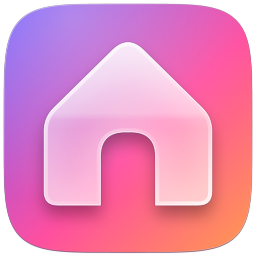
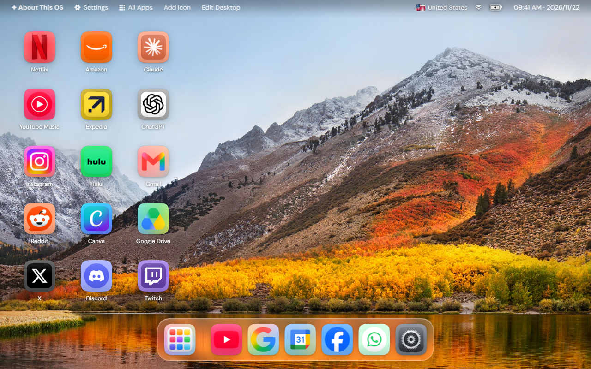
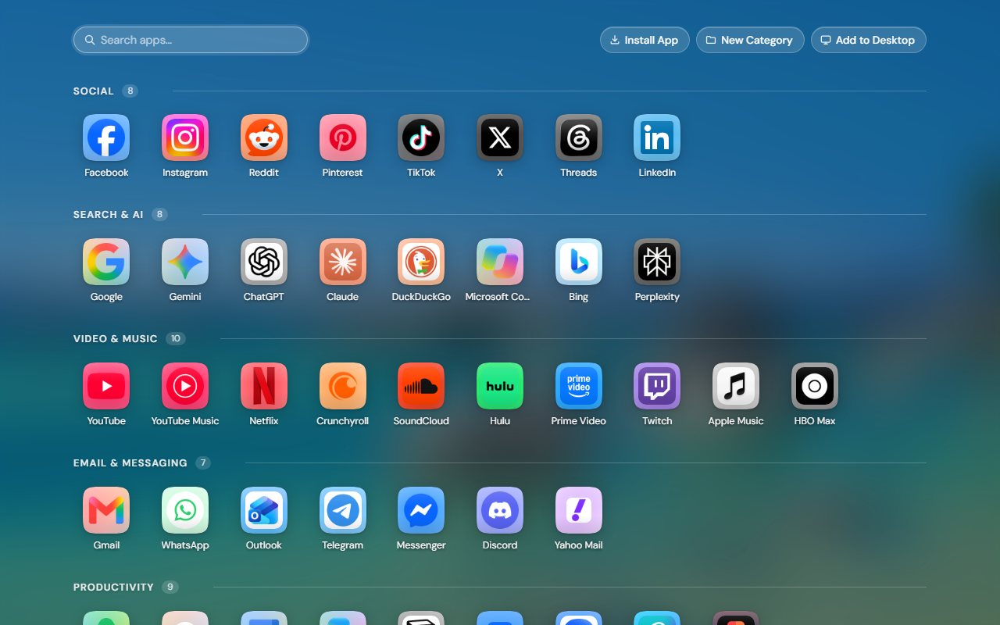
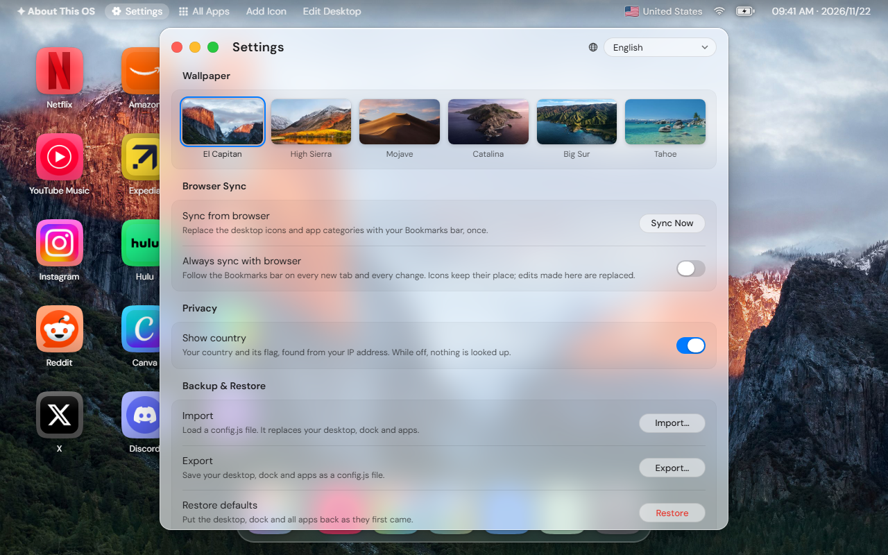

   

  
  
  

  <h1>Home Page OS - A New Era of Web Browsing</h1>
  
<b>The only home page you need.</b> Your bookmarks, synced from your browser, laid out as a desktop on every new tab.

## Screenshots

## Try it locally

Clone the repository. Open `index.html` directly in a browser. That's the whole setup.